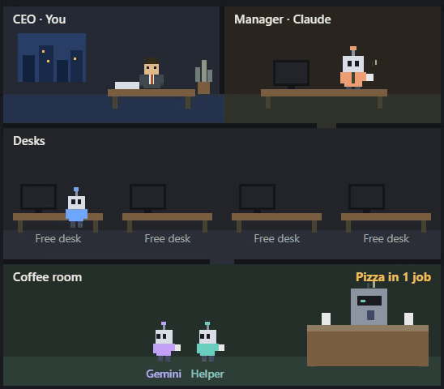

# Agent board animated

A small animated office for Claude Code. It shows the jobs Claude hands to other agents, so you can see who is working at a glance. As seen on @pluggedwith.ai.



- A running job gets a desk and a computer. There are four desks; extra jobs show as "+1 more".
- An agent with no job waits in the coffee room. When two or more are there, they chat.
- Claude is the manager, in their own office. When Claude has a question for you, they walk to your office.
- You are the CEO, in the corner office.
- Every 10 finished jobs, everyone gets a pizza. A countdown shows in the coffee room.

Below the office, the panel lists running jobs and recent results as text.

## Start here

This repo is only the board. Claude managing Codex and Gemini comes from a second repo, [delegate-to-codex-gemini](https://github.com/Canyouwritecode/delegate-to-codex-gemini). For the whole setup, you need both.

### What you need

- **Claude Code with the VS Code extension.** The office only draws in VS Code. In a terminal you get the text list, not the animation.
- **For real jobs:** the Codex CLI and the Antigravity CLI (`agy`), both signed in, and a git repository with at least one commit. The demo needs none of these.

### Install

1. Install the skills by following the [delegate-to-codex-gemini install steps](https://github.com/Canyouwritecode/delegate-to-codex-gemini#install).
2. Install the board by running these two commands in a terminal:

   ```
   claude plugin marketplace add https://github.com/Canyouwritecode/agent-board-animated.git
   claude plugin install agent-board-animated@agent-board-animated
   ```

3. Restart any open chats, then run the demo in Claude Code in VS Code:

   ```
   /agent-board-animated demo
   ```

## Use

The board opens by itself in a project that has a `.codex-tasks` or `.agent-tasks` folder. Anywhere else, run:

```
/agent-board-animated
```

The demo plays made-up jobs, so it works before you have run anything real.

## What it shows

| Worker | Where the board finds it |
|---|---|
| Codex | `.codex-tasks/<job>.md`, with `<job>.log` and `<job>.result.md` |
| Gemini | `.agent-tasks/<job>.md`, with `<job>.log` and `<job>.result.md` |
| Claude helper | Claude Code's own subagents |

The [delegate-to-codex-gemini](https://github.com/Canyouwritecode/delegate-to-codex-gemini) skills create these folders for you. Any tool that writes the same files will work too.

## Good to know

- The board needs a Claude Code version that supports mods. If it doesn't load, set `CLAUDE_CODE_ENABLE_FUNCTION_HOOKS=1` and restart.
- The text list shows job titles and the first line of each result. Keep that in mind when you share your screen or record it.
- The pizza countdown is kept per project.
- Jobs that were already finished when you installed the board don't count towards a pizza.

## Known limits

- A Codex job with a log over 4 MiB can show as working for up to 15 minutes after it stops.
- Helper filtering, the demo timers and the redraw hold have no automated tests yet.

## Development

```
claude plugin validate .
CLAUDE_CODE_ENABLE_FUNCTION_HOOKS=1 claude plugin test .
```

`tsc -p .` also works once Claude Code has loaded the mod, because the engine writes the type files into `.claude-plugin/types/`. Those files are generated and stay out of git.

## Licence

MIT. See [LICENSE](LICENSE).
